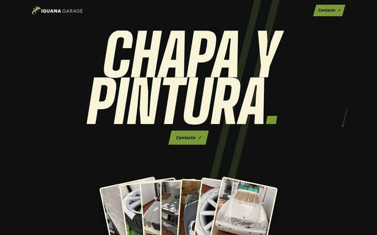
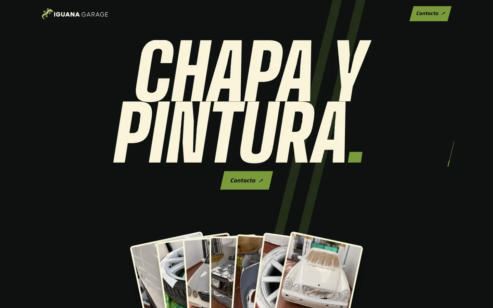
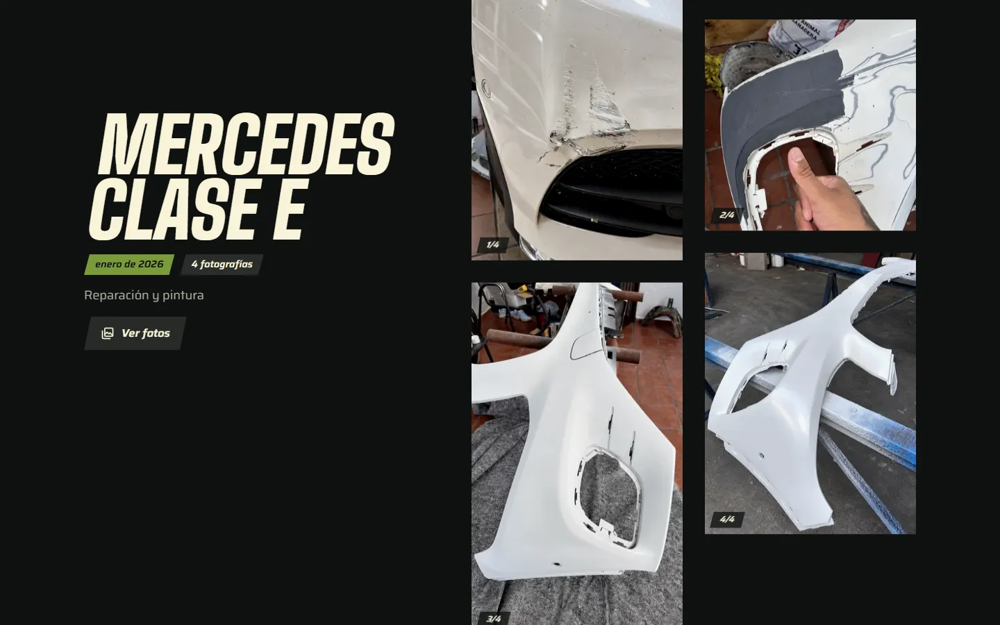
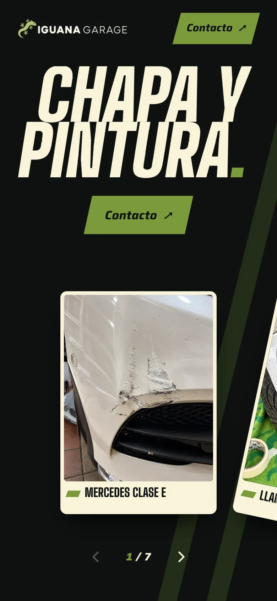
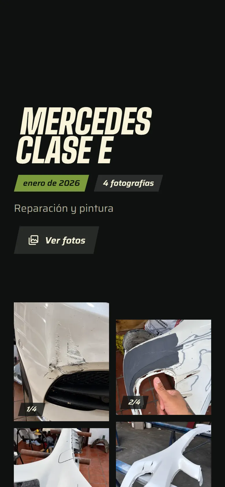
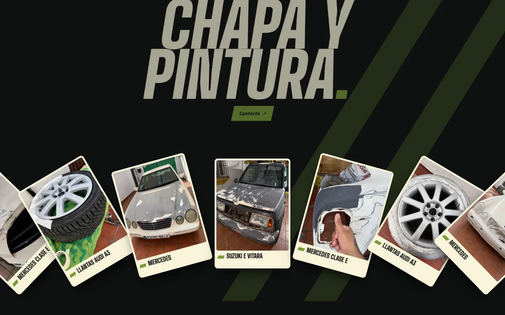
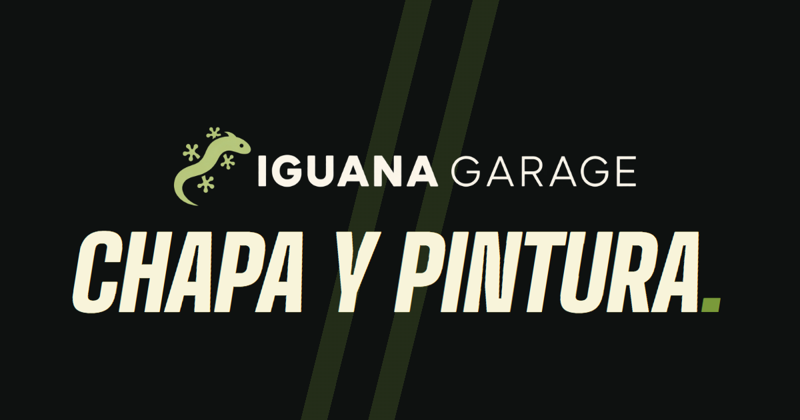

# Iguana Garage

**A real-world website for an auto body and paint shop: a photo-first public portfolio plus a private installable app (PWA) where the owner manages their work from a phone.**

🌐 **Live:** <https://iguana-garage.onrender.com>



## Context

Iguana Garage is a body and paint workshop. It needed a website that shows finished repairs honestly, with real phone photos taken in the shop, and a way for the owner to publish new work without a CMS or a developer.

The project is in production with real data and has two parts:

- **Public portfolio** at `/`: a single, motion-driven home page with the published jobs, a full-screen Before/After, a photo viewer and WhatsApp contact.
- **Private app** at `/app`: an installable PWA where the single owner uploads photos, edits jobs, orders the home page and decides what goes public.

## Screenshots

### Public site

| Desktop, first screen (1440 px) | Desktop, job mosaic (1440 px) |
| --- | --- |
|  |  |

| Mobile carousel (390 px) | Mobile job mosaic (390 px) | Open fan (desktop) |
| --- | --- | --- |
|  |  |  |

Link preview image (Open Graph), brand-only by design:



### Private app

| Job list | Home page management ("Portada") |
| --- | --- |
|  |  |

## Features

### Public site (`/`)

- **Card fan / carousel:** one card per job. On desktop the fan opens with the scroll; on phones and tablets it is a native `scroll-snap` carousel with a counter and arrow buttons.
- **Before/After:** an optional transformation chosen by the owner, shown as two full-screen views. With motion, the section pins and scrolling carries you horizontally from Before to After.
- **Jobs and photo mosaic:** published jobs in a manual order set by the owner, 12 per page, each with its photos in a staggered two-column mosaic and a focal point per photo.
- **Photo viewer:** native modal `dialog`, swipe strip that follows the finger, thumbnails, keyboard support, focus return and blurred-thumbnail placeholders while the full photo loads.
- **WhatsApp contact:** CTA and floating button built from a configured E.164 number, with a graceful "contact pending" state.
- **No public login link and no manifest**: the public side is fully separate from the private one.

### Private app (`/app`)

- **Auth:** email and password with Supabase Auth, validated on the server for every operation.
- **Jobs:** create, edit and delete with confirmation; name, date, optional paint code, private working hours and a short public description.
- **Photos:** JPEG, PNG or WebP up to 10 MiB / 40 MP; progress, retry and recovery from partial failures; per-photo focal point ("Encuadre").
- **"Portada" screen:** manage the home page in one place: drag to reorder jobs and photos (touch, mouse and keyboard), hide photos from the wall, pick the Before/After pair, and publish or unpublish a job instantly.
- **Installable PWA** scoped to `/app` (`display=standalone`), with no offline caching of private content.

## Tech stack and highlights

**Next.js 16 (App Router) · React 19 · TypeScript (strict) · Tailwind CSS 4 · Supabase · Sharp · Vitest · Playwright · PGlite**, deployed as a full Node web service on Render.

- **Supabase with RLS and private buckets.** Every table is protected by per-owner Row Level Security, and both Storage buckets (originals and derivatives) are private. The public site uses an anonymous, cookie-less client that can only call RPCs projecting published jobs; it never reads tables or originals. The application never uses a `service_role` key.
- **Image pipeline with Sharp and prepared variants.** Originals are stored byte for byte. At upload time Sharp produces an oriented, metadata-free WebP master (up to 1600 px) and sidecar variants (320/390/640/768). Delivery just streams the prepared bytes, so there is no image processing per request; the layouts pick variants through custom loaders and `sizes`.
- **Strict CSP.** A per-request nonce with `strict-dynamic` and no `unsafe-inline` for scripts, set from the Next.js proxy, which also guards `/app` and redirects the legacy `/login` route.
- **Private PWA.** The manifest is linked only from the `/app` layout, with `scope=/app`; the public home is outside of it. Revocable images and data are served `private, no-store`.
- **Scroll-driven animations with a fallback.** All scroll-linked motion (fan, Before/After, mosaic parallax) uses CSS `animation-timeline`, so it runs on the compositor with no JavaScript on scroll. Browsers without support get a fallback that writes CSS variables from a passive listener, one `requestAnimationFrame` write per frame. Only `transform` and `opacity` are animated. `prefers-reduced-motion` and no-JS get a static, fully usable layout.
- **Performance, measured.** Moving the scroll-linked motion off the main thread took dropped frames from **86 % to 0 %** under 4× CPU throttling. A Lighthouse run (mobile emulation, local production build) scores 100 for Accessibility, Best Practices and SEO, 0 CLS and 60 ms of total blocking time.
- **Accessibility.** 44 px touch targets, visible focus, labelled controls, announced reorder moves (including keyboard alternatives to every drag gesture), native dialog semantics in the viewer and reduced-motion support.
- **Atomic operations.** Reordering jobs and photos goes through PostgreSQL RPCs, and PostgreSQL/Storage mismatches are handled with explicit recovery and cleanup steps.

## Design process

The visual direction was explored, not guessed:

1. **Several prototypes** of the home page, in different styles, built and thrown away.
2. **Reference research:** ten award-winning or distinctive automotive and studio sites analysed for the technique behind them (macro photography, scroll-driven masks, stacked cards, light sweeps) and, just as importantly, what *not* to take.
3. **Concept pass and a visual taste test**, which pointed clearly at a racing-competition feel: condensed industrial type, dark with a green brand accent, a fan of photos on the cover and full-screen Before/After.
4. **Final design**, built around constraints that came from the material: mostly vertical, uneven phone photos, so the layout improves them through framing, a shared colour grade and rhythm instead of pretending they are studio shots.

The identity uses four official brand colours (Iguana Green, Carbon, Bone, Metal) and the official logo, untouched. Details are in [DESIGN.md](DESIGN.md).

## Testing

- **Vitest** unit and component tests for the portfolio contract, delivery, image loaders, motion logic and viewer.
- **PGlite** (in-process PostgreSQL) to test the data layer and RLS policies in isolation, with no remote database (`npm run test:isolated`).
- **Playwright** end-to-end tests at 390, 768 and 1440 px against the production build.

```sh
npm ci
npm run dev          # local development
npm test             # unit tests
npm run test:isolated
npm run typecheck && npm run lint
```

Environment variables, Supabase setup, deployment on Render and the rest of the commands are in **[docs/development.md](docs/development.md)**. It is written in Spanish, like the rest of the project documentation ([PRODUCT.md](PRODUCT.md), [DESIGN.md](DESIGN.md), [AGENTS.md](AGENTS.md)).

## Notes

The photos in this repository's screenshots are real work published on the live site. Brand assets in `assets/brand/` are the shop's identity and are not licensed for reuse.
